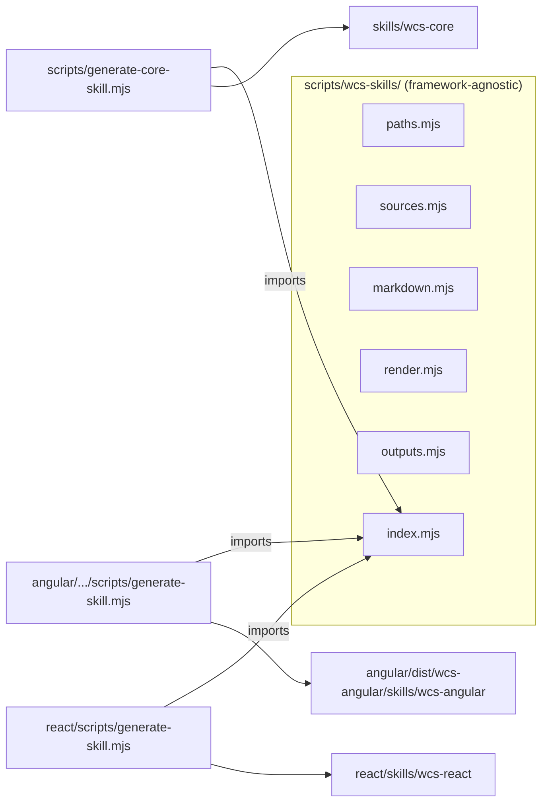

# About

This directory contains all scripts used for development, testing and building of the project.

# WCS skills generation

## Introduction

A **skill** is a `SKILL.md` file (plus its reference files) that packages version-exact knowledge of
WCS so an AI coding agent can consume a WCS release without guessing an API. Each published package
generates its **own** skill with its **own** script, so a project only ships the knowledge relevant
to how it actually uses WCS:

| Package       | Generated by                                              | Generated skill                                |
| :------------ | :-------------------------------------------------------- | :--------------------------------------------- |
| `wcs-core`    | `scripts/generate-core-skill.mjs`                         | `skills/wcs-core/`                             |
| `wcs-angular` | `angular/projects/wcs-angular/scripts/generate-skill.mjs` | `angular/dist/wcs-angular/skills/wcs-angular/` |
| `wcs-react`   | `react/scripts/generate-skill.mjs`                        | `react/skills/wcs-react/`                      |

`scripts/wcs-skills/` is a **framework-agnostic toolkit**, not an orchestrator: it knows how to read
`docs.json`, render a component reference, or assemble a `SKILL.md` from sections — it has no
knowledge of Angular, React, or any other consumer. Every framework-specific string (activation
description, prop/event syntax, which sections a skill has) is owned by that package's own
`generate-skill.mjs` script, which imports the toolkit through `scripts/wcs-skills/index.mjs`, its
only public entry point. This keeps the dependency direction correct: `wcs-core`'s build never needs
to know `wcs-angular` or `wcs-react` exist, and adding a new framework wrapper never requires editing
the toolkit.

## Sources of truth

The skills are **derived**, never hand-written. Each piece of content has a single authoritative
source, so there is never a second, divergent copy to keep in sync:

| Source                                                                                                    | Used for                                                                                     |
| :-------------------------------------------------------------------------------------------------------- | :------------------------------------------------------------------------------------------- |
| `stories/documentation/generated/docs.json`                                                               | The component API (props, events, methods, slots, CSS vars, parts). **The only API source.** |
| `custom-elements.json`                                                                                    | A warn-only cross-check that no tag drifted between the two manifests (never for content).   |
| `stories/components/**/*.stories.ts`                                                                      | Usage examples, copied **verbatim** (mapped to a tag via the `component: 'wcs-x'` literal).  |
| `stories/documentation/theming.mdx` + `design-tokens/dist/*.json`                                         | The theming reference and the discovered list of installed themes.                           |
| `stories/documentation/template.mdx`, `stories/documentation/accessibility.mdx`, `.../Getting Started/**` | The template, accessibility and getting-started references.                                  |
| `package.json` of each package                                                                            | The version stamped in every skill (see the version guard below).                            |

## How it works



The toolkit is split by responsibility, one file per concern:

| File                      | Responsibility                                                                                                                                                                                                                     |
| :------------------------ | :--------------------------------------------------------------------------------------------------------------------------------------------------------------------------------------------------------------------------------- |
| `wcs-skills/index.mjs`    | The **only** module a `generate-skill.mjs` script should import.                                                                                                                                                                   |
| `wcs-skills/paths.mjs`    | Shared source paths and `wcs-core`'s own output path (not the wrappers' — they own those).                                                                                                                                         |
| `wcs-skills/sources.mjs`  | Reads inputs: `readPackageInfo`/`assertSameVersionAsCore`, `docs.json`, the tag cross-check, the stories index.                                                                                                                    |
| `wcs-skills/markdown.mjs` | Pure string helpers (table builder, escaping, one-line summaries, relative links).                                                                                                                                                 |
| `wcs-skills/render.mjs`   | Generic Markdown builders: component references, editorial references, and the `SKILL.md` assembler (`renderSkillMd`, `section`, `linkTo`, `refLink`). No `SKILL.md` content is hard-coded here — callers pass their own sections. |
| `wcs-skills/outputs.mjs`  | Assembles file maps (`buildStoriesOutputs`, `buildComponentReferenceOutputs`), validates internal links, writes to disk.                                                                                                           |

Each package's `generate-skill.mjs` owns its own activation description, framework syntax, section
list and output directory — see `scripts/generate-core-skill.mjs` for the reference shape.

### Output structure

Only `wcs-core` ships the full reference set (one page per component, stories copied verbatim,
styles/tokens/template/accessibility references, and `audit-tokens.js`). `wcs-angular` and
`wcs-react` each ship a `SKILL.md` plus their **own** `references/getting-started.md`; everything
else is linked into `wcs-core`'s references through Node module resolution
(`wcs-core/skills/wcs-core/...`), since both wrappers depend on the exact same `wcs-core` version.

```
skills/wcs-core/
├── SKILL.md
└── references/
    ├── components/<tag>/<tag>.md
    ├── stories/<...>.stories.ts
    ├── tokens/theming.md
    ├── template.md
    ├── accessibility.md
    └── getting-started.md
scripts/audit-tokens.js copied alongside, at scripts/audit-tokens.js

<wrapper>/skills/wcs-<wrapper>/
├── SKILL.md                     # links into wcs-core/skills/wcs-core/... for shared references
└── references/getting-started.md  # this wrapper's own installation guide
```

### Version guard

`wcs-angular` and `wcs-react` are always released at the same version as `wcs-core` (see
`update-version.js`). Each wrapper's own `generate-skill.mjs` calls `assertSameVersionAsCore` and
**fails fast** if its version or its `wcs-core` dependency does not match `wcs-core`'s, because a
mismatch would make its skill reference the wrong release. It also fails fast (a single, clear error)
if `wcs-core`'s skill has not been generated yet, since its `SKILL.md` links into it.

## Examples

### Generating the skills locally

```shell
npm run generate-skills            # wcs-core only, from the repo root
node angular/projects/wcs-angular/scripts/generate-skill.mjs   # requires wcs-core's skill to exist
node react/scripts/generate-skill.mjs                          # requires wcs-core's skill to exist
```

The output folders are git-ignored (like `dist/`, `bundle/`, ...): they are build artifacts,
generated — not committed. `npm run generate-skills` is wired into the root `build` script, right
after `generate-custom-element-manifest`.

> If `docs.json` is stale, regenerate it first with `npm run generate-docs-json`.

### Shipping the Angular skill

`ng-packagr` has no generic "copy extra static files" mechanism, so the Angular script writes
**directly** into the published package output (`angular/dist/wcs-angular/skills/wcs-angular` by
default). `build:wcs-angular` runs it right after `ng build`. Pass `--out <path>` to override the
output directory for local testing.

### Shipping the React skill

`react`'s own `build` script runs `scripts/generate-skill.mjs` after compiling, writing to
`react/skills/wcs-react` (already listed in `react/package.json`'s `files`). Pass `--out <path>` to
override the output directory for local testing.

### Adding a component to the skills

Nothing to do: components are read from `docs.json`, so a new component (and its stories) appears in
`wcs-core`'s skill automatically the next time it is generated. Keep the component's JSDoc and its
`*.stories.ts` accurate — that is what ends up in the skill.

### Adding a new framework wrapper

Create `<wrapper>/scripts/generate-skill.mjs`, importing only from `scripts/wcs-skills/index.mjs`
(relative path to the repo root). Follow the shape of `angular/projects/wcs-angular/scripts/generate-skill.mjs`
or `react/scripts/generate-skill.mjs`: read the wrapper's own `package.json`, call
`assertSameVersionAsCore`, build its own sections (activation description, framework syntax, links
into `wcs-core`'s references), and write its own output directory. No change to the toolkit or to
`wcs-core`'s script is needed.
